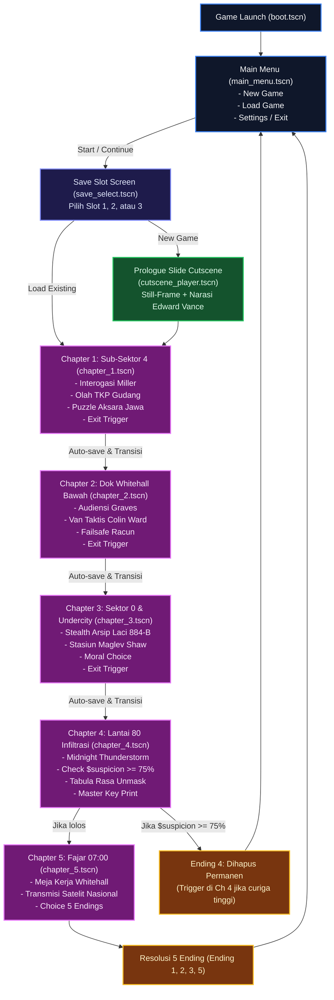

# GODOT 4 MASTER AI ARCHITECTURE BLUEPRINT
## *The Lethe Protocol: Concord 2084 — End-to-End Game Integration Plan*

**Target Audience:** AI Coding Agent (Antigravity / Claude / Cursor / Copilot) & Development Team (Kelompok 5).  
**Engine Target:** Godot Engine 4.x (Standard 2D, GDScript 2.0).  
**Tujuan Dokumen:** Memberikan cetak biru teknis lengkap, modular, dan bebas konflik Git agar AI Agent dapat membangun dan mengintegrasikan seluruh sistem game (Main Menu $\rightarrow$ Save System $\rightarrow$ Prologue Slide $\rightarrow$ Chapter 1–5 $\rightarrow$ 5 Endings $\rightarrow$ Mind Vault & UI Overlay) menjadi game yang utuh dan dapat dimainkan (*fully playable*).

---

## 1. GAMEPLAY FLOW & STATE MACHINE ARSITEKTUR



---

## 2. STRUKTUR DIREKTORI PROYEK (GIT-FRIENDLY)

Struktur folder dirancang terisolasi per fitur dan per chapter agar 5 anggota tim dapat bekerja secara simultan tanpa risiko *Git Merge Conflict* pada file `.tscn`:

```text
res://
├── assets/
│   ├── audio/
│   │   ├── bgm/             # Musik latar (ambient_rain.ogg, kidung.ogg, etc.)
│   │   └── sfx/             # Efek suara (gunshot.wav, dial_click.wav, etc.)
│   ├── characters/          # Spritesheet karakter pixel art
│   ├── cutscenes/           # Gambar still-frame untuk cutscene (PNG)
│   ├── maps/                # Tileset & tilemap textures
│   └── ui/                  # Icon, border, font, patch style
│
├── data/
│   ├── dialogues/           # File data percakapan (JSON)
│   │   ├── chapter_1_dialogue.json
│   │   └── chapter_2_dialogue.json
│   └── evidence/            # Database barang bukti & deduksi
│       └── evidence_database.json
│
├── scenes/
│   ├── autoload/            # Scene singleton persisten
│   │   └── ui_manager.tscn  # CanvasLayer untuk Dialogue, MindVault, Inventory
│   ├── chapters/            # Folder terisolasi per chapter
│   │   ├── chapter_1/       # Dikerjakan Anggota A
│   │   │   ├── chapter_1.tscn
│   │   │   └── chapter_1.gd
│   │   ├── chapter_2/       # Dikerjakan Anggota B
│   │   │   ├── chapter_2.tscn
│   │   │   └── chapter_2.gd
│   │   ├── chapter_3/
│   │   │   ├── chapter_3.tscn
│   │   │   └── chapter_3.gd
│   │   ├── chapter_4/
│   │   │   ├── chapter_4.tscn
│   │   │   └── chapter_4.gd
│   │   └── chapter_5/
│   │       ├── chapter_5.tscn
│   │       └── chapter_5.gd
│   ├── common/              # Komponen yang dapat dipakai ulang (reusable)
│   │   ├── player.tscn      # Karakter Arthur Vance
│   │   ├── interactable.tscn# Trigger area inspeksi objek
│   │   └── exit_trigger.tscn# Pemicu selesai chapter
│   ├── cutscenes/
│   │   ├── cutscene_player.tscn
│   │   └── cutscene_player.gd
│   └── menu/
│       ├── main_menu.tscn
│       ├── main_menu.gd
│       ├── save_select.tscn
│       └── save_select.gd
│
└── scripts/
    ├── autoload/            # Core Singletons (Didaftarkan di Project Settings)
    │   ├── GameManager.gd   # State variabel, memori, kecurigaan, babak aktif
    │   ├── SaveManager.gd   # Baca/tulis JSON ke user://saves/
    │   └── DialogueManager.gd # Penangan teks, parser, dan trigger sinyal
    └── puzzle/
        └── affine_puzzle.gd # Logika translasi, rotasi, skalasi aksara Jawa
```

---

## 3. SKEMA DATA PENYIMPANAN (SAVE FILE JSON)

File disimpan di path: `user://saves/slot_{id}.json` (Contoh: `user://saves/slot_1.json`).

### 3.1 Skema JSON Baku
```json
{
  "version": "1.0",
  "save_timestamp": "2026-11-23 12:00:00",
  "slot_id": 1,
  "game_state": {
    "current_chapter": 1,
    "chapter_title": "Kidung yang Hilang & Jejak Sub-Sektor 4",
    "player_spawn_point": "spawn_default",
    "tonictaken": true
  },
  "psychological_variables": {
    "memory_meter": 15,
    "suspicion_meter": 10
  },
  "inventory": {
    "evidence_collected": [
      "EVID-001",
      "EVID-101",
      "EVID-102",
      "EVID-103",
      "EVID-104"
    ],
    "unlocked_deductions": [
      "DEDUKSI-101"
    ]
  },
  "story_flags": {
    "prologue_completed": true,
    "miller_interrogated": true,
    "puzzle_ja_completed": true,
    "warehouse_evidence_hidden": false,
    "colin_sparrow_met": false,
    "garrick_shaw_saved": false,
    "master_key_assembled": false
  }
}
```

---

## 4. KONTRAK AUTOLOAD & ARSITEKTUR KODE INTI

Godot Engine memerlukan 3 Autoload Singleton yang didaftarkan di **Project Settings -> Autoload**:
1. `GameManager` (`res://scripts/autoload/GameManager.gd`)
2. `SaveManager` (`res://scripts/autoload/SaveManager.gd`)
3. `UIManager` (`res://scenes/autoload/ui_manager.tscn`)

---

### 4.1 Script: `GameManager.gd` (Central State & Variables)
```gdscript
extends Node

# --- SINYAL GLOBAL ---
signal memory_changed(new_value: int)
signal suspicion_changed(new_value: int)
signal inventory_updated()
signal deduction_unlocked(deduction_id: String)
signal chapter_transition_started(target_chapter: int)

# --- VARIABEL KOGNITIF & STATUS ---
var current_slot: int = 1
var current_chapter: int = 1
var memory_meter: int = 0:
	set(val):
		memory_meter = clamp(val, 0, 100)
		memory_changed.emit(memory_meter)

var suspicion_meter: int = 0:
	set(val):
		suspicion_meter = clamp(val, 0, 100)
		suspicion_changed.emit(suspicion_meter)

var collected_evidence: Array[String] = []
var unlocked_deductions: Array[String] = []
var story_flags: Dictionary = {}

func reset_to_new_game(slot_id: int):
	current_slot = slot_id
	current_chapter = 0 # 0 = Prologue
	memory_meter = 0
	suspicion_meter = 0
	collected_evidence.clear()
	unlocked_deductions.clear()
	story_flags = {
		"prologue_completed": false,
		"miller_interrogated": false,
		"puzzle_ja_completed": false,
		"colin_sparrow_met": false,
		"garrick_shaw_saved": false,
		"master_key_assembled": false
	}

func add_evidence(evidence_id: String):
	if not collected_evidence.has(evidence_id):
		collected_evidence.append(evidence_id)
		inventory_updated.emit()

func unlock_deduction(deduction_id: String, bonus_memory: int = 10):
	if not unlocked_deductions.has(deduction_id):
		unlocked_deductions.append(deduction_id)
		memory_meter += bonus_memory
		deduction_unlocked.emit(deduction_id)

func advance_to_chapter(chapter_number: int):
	current_chapter = chapter_number
	SaveManager.save_game(current_slot)
	chapter_transition_started.emit(chapter_number)
	
	var chapter_path = "res://scenes/chapters/chapter_%d/chapter_%d.tscn" % [chapter_number, chapter_number]
	if ResourceLoader.exists(chapter_path):
		get_tree().change_scene_to_file(chapter_path)
	else:
		push_error("Chapter scene not found: " + chapter_path)
```

---

### 4.2 Script: `SaveManager.gd` (JSON Persistence)
```gdscript
extends Node

const SAVE_DIR = "user://saves/"

func _ready():
	if not DirAccess.dir_exists_absolute(SAVE_DIR):
		DirAccess.make_dir_recursive_absolute(SAVE_DIR)

func get_save_path(slot: int) -> String:
	return SAVE_DIR + "slot_%d.json" % slot

func has_save_file(slot: int) -> bool:
	return FileAccess.file_exists(get_save_path(slot))

func save_game(slot: int) -> bool:
	var data = {
		"version": "1.0",
		"save_timestamp": Time.get_datetime_string_from_system(),
		"slot_id": slot,
		"game_state": {
			"current_chapter": GameManager.current_chapter
		},
		"psychological_variables": {
			"memory_meter": GameManager.memory_meter,
			"suspicion_meter": GameManager.suspicion_meter
		},
		"inventory": {
			"evidence_collected": GameManager.collected_evidence,
			"unlocked_deductions": GameManager.unlocked_deductions
		},
		"story_flags": GameManager.story_flags
	}
	
	var file = FileAccess.open(get_save_path(slot), FileAccess.WRITE)
	if not file:
		push_error("Gagal membuka file save untuk ditulis: " + get_save_path(slot))
		return false
	
	file.store_string(JSON.stringify(data, "\t"))
	file.close()
	print("Game tersimpan di slot: ", slot)
	return true

func load_game(slot: int) -> bool:
	if not has_save_file(slot):
		push_warning("File save tidak ditemukan untuk slot: %d" % slot)
		return false
	
	var file = FileAccess.open(get_save_path(slot), FileAccess.READ)
	var content = file.get_as_text()
	file.close()
	
	var parsed = JSON.parse_string(content)
	if parsed == null:
		push_error("Gagal parsing JSON save file slot: %d" % slot)
		return false
	
	GameManager.current_slot = slot
	GameManager.current_chapter = parsed["game_state"]["current_chapter"]
	GameManager.memory_meter = parsed["psychological_variables"]["memory_meter"]
	GameManager.suspicion_meter = parsed["psychological_variables"]["suspicion_meter"]
	GameManager.collected_evidence = parsed["inventory"]["evidence_collected"]
	GameManager.unlocked_deductions = parsed["inventory"]["unlocked_deductions"]
	GameManager.story_flags = parsed["story_flags"]
	
	# Pindah ke scene chapter terkait
	if GameManager.current_chapter == 0:
		get_tree().change_scene_to_file("res://scenes/cutscenes/cutscene_player.tscn")
	else:
		var scene_path = "res://scenes/chapters/chapter_%d/chapter_%d.tscn" % [GameManager.current_chapter, GameManager.current_chapter]
		get_tree().change_scene_to_file(scene_path)
	
	return true
```

---

### 4.3 Script: `UIManager.gd` (Persistent Overlay CanvasLayer)
```gdscript
extends CanvasLayer

@onready var dialogue_box = $DialogueBox
@onready var inventory_ui = $InventoryUI
@onready var mind_vault_ui = $MindVaultUI
@onready var hud_panel = $HUDPanel
@onready var fade_rect = $FadeRect

func _ready():
	# Sembunyikan semua UI saat game start / menu
	dialogue_box.hide()
	inventory_ui.hide()
	mind_vault_ui.hide()
	hud_panel.hide()
	fade_rect.modulate.a = 0.0

func _input(event):
	# Toggle Mind Vault dengan tombol TAB
	if event.is_action_just_pressed("ui_focus_next"): # Default TAB
		if mind_vault_ui.visible:
			mind_vault_ui.hide()
		else:
			mind_vault_ui.show_and_refresh()

func show_hud(show: bool):
	hud_panel.visible = show

func play_fade_transition(fade_out: bool, duration: float = 0.5) -> void:
	var tween = create_tween()
	if fade_out:
		tween.tween_property(fade_rect, "modulate:a", 1.0, duration)
	else:
		tween.tween_property(fade_rect, "modulate:a", 0.0, duration)
	await tween.finished
```

---

### 4.4 Script: `cutscene_player.gd` (Visual Novel Still-Frame Slide)
```gdscript
extends Control

@export var slides: Array[Texture2D] = []
@export var narrative_texts: Array[String] = []
@export var next_scene_chapter: int = 1

@onready var texture_rect = $SlideTexture
@onready var label_text = $TextPanel/NarrativeLabel
@onready var audio_player = $AudioStreamPlayer

var current_slide_index: int = 0

func _ready():
	UIManager.show_hud(false)
	show_slide(0)

func _input(event):
	if event.is_action_just_pressed("ui_accept") or (event is InputEventMouseButton and event.pressed and event.button_index == MOUSE_BUTTON_LEFT):
		advance_slide()

func show_slide(idx: int):
	if idx < slides.size():
		texture_rect.texture = slides[idx]
	if idx < narrative_texts.size():
		label_text.text = narrative_texts[idx]

func advance_slide():
	current_slide_index += 1
	if current_slide_index < slides.size():
		show_slide(current_slide_index)
	else:
		finish_cutscene()

func finish_cutscene():
	await UIManager.play_fade_transition(true, 0.8)
	GameManager.story_flags["prologue_completed"] = true
	GameManager.advance_to_chapter(next_scene_chapter)
	await UIManager.play_fade_transition(false, 0.8)
	UIManager.show_hud(true)
```

---

## 5. REUSABLE COMPONENT: EXIT TRIGGER & CHAPTER COMPLETION

Setiap chapter memiliki sebuah node penutup: `exit_trigger.tscn`. Node ini memeriksa apakah objektif esensial chapter sudah selesai sebelum mengizinkan pemain lanjut ke chapter berikutnya.

### Script: `exit_trigger.gd`
```gdscript
extends Area2D

@export var target_next_chapter: int = 2
@export var required_flag: String = "miller_interrogated"
@export var prompt_message: String = "Lanjutkan ke Chapter Berikutnya? (Tekan E)"

var player_in_zone: bool = false

func _ready():
	body_entered.connect(_on_body_entered)
	body_exited.connect(_on_body_exited)

func _on_body_entered(body):
	if body.name == "Player":
		player_in_zone = true

func _on_body_exited(body):
	if body.name == "Player":
		player_in_zone = false

func _process(_delta):
	if player_in_zone and Input.is_action_just_pressed("interact"):
		try_transition()

func try_transition():
	# Cek apakah syarat minimal terpenuhi
	if required_flag != "" and not GameManager.story_flags.get(required_flag, false):
		# Tampilkan dialog bahwa investigasi belum selesai
		UIManager.dialogue_box.show_message("Arthur Vance", "Saya belum bisa meninggalkan area ini. Masih ada petunjuk kunci yang harus diselesaikan.")
		return
	
	# Transisi ke babak selanjutnya
	GameManager.advance_to_chapter(target_next_chapter)
```

---

## 6. LANGKAH-LANGKAH IMPLEMENTASI AI AGENT (TASK BREAKDOWN)

AI Coding Agent harus menjalankan pembangunan sistem game secara terurut mengikuti 5 tugas (*tasks*) mandiri berikut:

### 🎯 Task 1: Setup Core Autoload & Save System
1. Buat folder `scripts/autoload/` dan daftarkan `GameManager.gd` serta `SaveManager.gd` ke dalam `project.godot`.
2. Implementasikan fungsi `save_game(slot)` dan `load_game(slot)` berbasis JSON ke `user://saves/`.
3. Verifikasi: Buat unit test kecil untuk memastikan file JSON terbuat dan terbaca dengan benar.

### 🎯 Task 2: Main Menu & Save Slot Selection Scene
1. Buat scene `scenes/menu/main_menu.tscn`:
   - Tombol **Start Game**, **Load Game**, **Settings**, **Exit**.
2. Buat scene `scenes/menu/save_select.tscn`:
   - Menampilkan 3 kartu slot save (`Slot 1`, `Slot 2`, `Slot 3`).
   - Setiap kartu menampilkan: Tanggal Simpan, Babak Terakhir, dan Status ($memory & $suspicion).
   - Jika slot kosong: Menampilkan tombol **"New Game"** $\rightarrow$ memanggil `GameManager.reset_to_new_game(slot_id)` lalu mengarahkan ke cutscene Prologue.
   - Jika slot terisi: Menampilkan tombol **"Continue"** $\rightarrow$ memanggil `SaveManager.load_game(slot_id)`.

### 🎯 Task 3: Cutscene Player (Visual Novel Still-Frame)
1. Buat scene `scenes/cutscenes/cutscene_player.tscn` dengan script `cutscene_player.gd`.
2. Masukkan array teks prolog dan gambar still-frame (Scene 1: Rumah panggung $\rightarrow$ Scene 2: Serbuan Graves $\rightarrow$ Scene 3: Kematian Edward $\rightarrow$ Scene 4: Apartemen 2084).
3. Pastikan tombol klik/spasi memajukan slide dan di akhir slide otomatis memanggil `GameManager.advance_to_chapter(1)`.

### 🎯 Task 4: Integrasi Chapter 1 & Olah TKP
1. Buat scene `scenes/chapters/chapter_1/chapter_1.tscn` yang memuat:
   - Tilemap lantai gudang Sub-Sektor 4 & ruang interogasi Whitehall.
   - Instance `player.tscn` dengan kontrol gerak W, A, S, D.
   - 3 node `interactable.tscn` untuk bukti: Puntung kretek `EVID-103`, Coretan UV `EVID-104`, dan Generator `EVID-105`.
   - Node puzzle `affine_puzzle.tscn` pada generator.
2. Tempatkan `exit_trigger.tscn` di pintu keluar / mobil patroli dengan konfigurasi `target_next_chapter = 2`.

### 🎯 Task 5: Rantai Transisi Chapter 2 s.d. Chapter 5 & Endings
1. Buat prefab kosong/dasar untuk `chapter_2.tscn`, `chapter_3.tscn`, `chapter_4.tscn`, dan `chapter_5.tscn`.
2. Pada `chapter_4.tscn`, sisipkan script pengecekan otomatis:
   ```gdscript
   if GameManager.suspicion_meter >= 75:
       get_tree().change_scene_to_file("res://scenes/endings/ending_4.tscn")
   ```
3. Pada `chapter_5.tscn`, sediakan tombol interaksi terminal meja kerja yang membuka panel dialog untuk memilih salah satu dari 4 ending yang memenuhi syarat kognitif.

---

## 7. CEKLIS KESIAPAN MERGE GIT (TIM COLLABORATION)

Agar tidak terjadi *conflict* saat seluruh tim melakukan `git push` dan `git pull`:
* [ ] Tidak ada anggota tim yang menyentuh scene `.tscn` milik chapter lain.
* [ ] Setiap modifikasi data global **HANYA** dipanggil lewat fungsi sinyal `GameManager.*`.
* [ ] Aset gambar baru selalu disimpan di folder masing-masing `assets/...` tanpa menimpa file yang sudah ada.
* [ ] Penambahan dialog baru ditulis ke dalam file JSON `data/dialogues/` terpisah per chapter.

---
*(SELESAI — DOKUMEN ARSITEKTUR SIAP DIJALANKAN OLEH AI CODING AGENT)*
