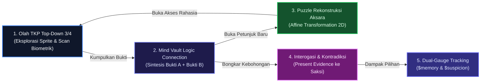
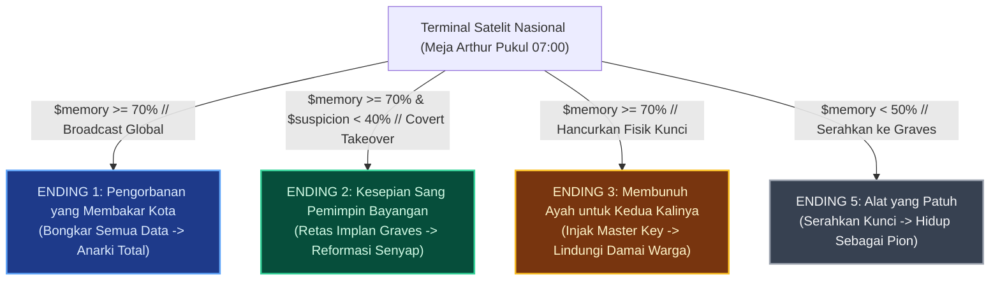

# DOKUMEN DESAIN GAMEPLAY & SPESIFIKASI INVESTIGASI
## *The Lethe Protocol: Concord 2084 (Gameplay, Level, Evidence & Mind Vault Design)*

**Dokumen Rujukan:**  
* Proposal Capstone Project Kelompok 5 (*The Lethe Protocol: Concord 2084*)  
* [naskah_5chapter.md](file:///home/zharfanfw/documents/kuliah/semester5/capstone-naratif/naskah_5chapter.md)  
* [the-lethe-protocol_5chapter.twee](file:///home/zharfanfw/documents/kuliah/semester5/capstone-naratif/the-lethe-protocol_5chapter.twee)  

**Tim Pengembang (Kelompok 5):**  
* Harri Supriadi (2405547)  
* Maula Mirza Ananda (2407087)  
* Muhiban Fadlan Nursaid (2400382)  
* Zahran Zaidan Saputra (2415429)  
* Zharfan Faza Wibawa (2403995)  

**Target Audiens Dokumen:** Programmer Gameplay, UI/UX Designer, Pixel Artist, Level Designer, dan Narrative Designer.

---

## 1. ARSITEKTUR CORE GAMEPLAY & SISTEM INVESTIGASI

Game dirancang dengan gaya **Detective Adventure / Puzzle Noir** berakar estetika Nusantara futuristik (Inspirasi utama: *Ace Attorney Investigations: Miles Edgeworth* dipadukan dengan atmosfer *Cyberpunk Dystopia*).



### 1.1 Top-Down 3/4 Scene Investigation
* Pemain menggerakkan sprite pixel-art Arthur Vance secara bebas di lingkungan isometrik 3/4.
* Objek yang dapat diinteraksi ditandai dengan **Indikator Pendar (Cyan Glow / Gold Glow)** saat Arthur mendekat dalam radius 1.5 tile.
* Menekan tombol `[E] / [Inspect]` memicu mode inspeksi mendalam: zoom-in kamera 2D dengan analisis teks biometrik birokrasi.

### 1.2 Mind Vault (Logic & Deduction Connection System)
* Menu khusus yang dapat dibuka kapan saja menggunakan tombol `[TAB] / [Mind Vault]`.
* Berisi kepingan-kepingan premis mentah (*Clues/Premises*) yang ditemukan dari TKP atau dialog.
* **Mekanik:** Pemain memilih dua keping bukti/premis, lalu menekan tombol `[SYNTHESIZE]`.
  * **Jika Cocok (Valid Connection):** Muncul animasi glitch keemasan, kepingan bersatu, menghasilkan **Deduksi Baru**, memulihkan `$memory`, serta membuka opsi dialog atau lokasi baru.
  * **Jika Salah (Invalid):** Efek suara buzzer digital (*error chirp*), layar berkedip merah tipis tanpa penalti berat.

### 1.3 Puzzle Rekonstruksi Aksara Nusantara (Affine Transformation)
* Digunakan pada terminal, dinding beton, atau artefak yang terkunci enkripsi kelompok perlawanan.
* Tampilan layar penuh 2D memperlihatkan pecahan garis hologram emas yang terpecah menjadi 2–4 fragmen.
* **Kontrol Manipulasi:**
  * **Translasi:** Menggeser koordinat posisi sumbu X dan Y.
  * **Rotasi:** Memutar sudut pecahan garis ($0^\circ$ – $360^\circ$).
  * **Skalasi:** Mengubah rasio ukuran pecahan ($50\%$ – $150\%$).
* **Kondisi Menang:** Seluruh fragmen menyatu dengan batas toleransi $\le 5\%$ error, membentuk satu karakter Aksara Nusantara (misal: "JA"), yang memicu pelepasan kunci magnetik.

### 1.4 Dual-Gauge Psychological Tracking
* **Memory Meter (`$memory`, 0–100%):** Mengukur seberapa utuh ingatan jati diri Arthur. Bertambah setiap kali Arthur menemukan peninggalan ayahnya atau melakukan sintesis logika masa lalu.
* **Bureau Suspicion Meter (`$suspicion`, 0–100%):** Mengukur kecurigaan Detective Miles Prescott dan Director Graves. Bertambah jika Arthur bersikap empati pada buronan, memalsukan alibi secara ceroboh, atau menyembunyikan bukti. Ambang bahaya $\ge 75\%$ di Chapter 4 langsung memicu *Game Over*.

---

# PROLOG: JANJI DI MALAM HUJAN (TUTORIAL INVESTIGASI)

### 1. Peta Lingkungan & Atmosfer Level
* **Lokasi:** Rumah Panggung Kayu (Masa Lalu).
* **Ukuran Level:** 1 Ruang Utama (12 x 8 tile).
* **Palet Warna:** Amber jingga hangat, cokelat kayu jati tua, bayangan lentera dinamis.
* **Audio:** Suara gemuruh hujan lebat di luar, petikan senar bambu lembut.

```
+-------------------------------------------------------+
|  [Jendela Kayu: Hujan Lebat]         [Rak Buku Kuno]  |
|                                                       |
|                     [Tikar Pandan]                    |
|                (Edward Vance & Arthur)                |
|                                                       |
|                                                       |
|  [Pintu Depan: Kayu Ulin]            [Lampu Lentera]  |
+-------------------------------------------------------+
```

### 2. Walkthrough Pemain (Langkah demi Langkah)
1. **Tutorial Pergerakan:** Pemain menggerakkan Arthur kecil mendekati Edward Vance di atas tikar pandan.
2. **Tutorial Interaksi:** Menekan `[E]` pada lempengan kayu di tangan Edward. Dialog ayah-anak dimulai.
3. **Pemicu Peristiwa (Cutscene Serangan):** Graves dan tentara mendobrak pintu depan.
4. **Pemeriksaan Objek Pasca-Tembakan:** Pemain menggerakkan Arthur kecil mendekati tubuh Edward yang tertembak.
5. **Perolehan Bukti Pertama:** Menekan `[E]` pada tangan Edward untuk menerima **Lempengan Ukiran Kayu Beraksara**.
6. **Transisi Kognitif:** Layar mengalami *chromatic aberration* menuju apartemen tahun 2084.

### 3. Database Barang Bukti Prolog
| ID Bukti | Nama Bukti | Kategori | Deskripsi Inspeksi Forensik |
| :--- | :--- | :--- | :--- |
| `EVID-001` | **Lempengan Ukiran Kayu Ayah** | Fisik / Artefak | Lempengan kayu ulin kecil dengan ukiran Aksara Nusantara kuno. Masih bernoda darah segar Edward Vance. |
| `EVID-002` | **Tembang Leluhur (Kidung)** | Memori / Audio | Nada melodi pengantar tidur tentang perahu kayu dan tanah air yang disenandungkan Edward sebelum meninggal. |

---

# CHAPTER 1: KIDUNG YANG HILANG & JEJAK SUB-SEKTOR 4

### 1. Peta Lingkungan & Denah Level

#### Area 1.A: Ruang Interogasi Unit V-09 (Whitehall Complex)
* **Visual:** Monokrom kelabu dingin, lampu neon fluorescent putih tajam.
* **Objek Interaktif:** Meja interogasi logam, perangkat pemutar kaset analog, cangkir kopi Prescott, monitor birokrasi.

#### Area 1.B: Gudang Terbengkalai (Sub-Sektor 4)
* **Ukuran Level:** 20 x 14 tile (Gudang luas industri kumuh).
* **Visual:** Dinding beton basah berlumut, genangan air memantulkan lampu neon merah pabrik, uap panas dari pipa bocor.

```
+-------------------------------------------------------------------+
| [Pintu Darurat Dirusak]               [Kisi Ventilasi Fosfor (UV)]|
|                                                                   |
|       [Kotak Kargo Suku Cadang]            [Genangan Air Asam]    |
|                                                                   |
| [Tong Oli Berkarat: Puntung Rokok]                                |
|                                                                   |
|                                        [Generator Tua Berhologram]|
| [Pintu Masuk Utama: Prescott Berdiri]                             |
+-------------------------------------------------------------------+
```

---

### 2. Walkthrough Aktivitas Pemain
1. **Fajar di Apartemen:** Pemain memilih menelan *The Tonic* (taat) atau membiarkannya di meja (ragu).
2. **Sesi Interogasi Miller (Ruang Interogasi):**
   * Pemain memeriksa kaset analog di atas meja (`EVID-101`).
   * Memutar kaset, memicu resonansi memori kidung.
   * Melakukan interogasi pada Miller. Mengajukan pertanyaan tentang frekuensi pemancar untuk memperoleh keterangan `EVID-102` (Testimoni Miller).
3. **Transisi ke Gudang Sub-Sektor 4:** Pemain dan Prescott tiba di lokasi sabotase.
4. **Olah TKP Bebas (Investigasi 3 Titik):**
   * Berjalan ke dekat tong oli berkarat $\rightarrow$ Memeriksa `EVID-103` (Puntung Kretek Black Clove).
   * Berjalan ke kisi-kisi ventilasi $\rightarrow$ Menyalakan senter UV $\rightarrow$ Mengamati `EVID-104` (Coretan Hex 0x4F5552).
   * Berjalan ke generator tua $\rightarrow$ Mengamati proyektor hologram teracak.
5. **Eksekusi Mind Vault (Sintesis Logika):**
   * Membuka menu Mind Vault (`[TAB]`).
   * Menghubungkan `EVID-102` + `EVID-104` $\rightarrow$ Menghasilkan **DEDUKSI-101**.
6. **Mekanik Puzzle Rekonstruksi Aksara:**
   * Berinteraksi dengan generator tua.
   * Masuk ke layar *Affine Transformation*. Memanipulasi 3 pecahan garis hingga membentuk karakter aksara **"JA"**.
   * Kompartemen terbuka $\rightarrow$ Mengambil `EVID-105` (Peta Rute Dok Bawah & Catatan "Thur").
7. **Resolusi Babak (Pilihan Moral):**
   * Memilih apakah melaporkan rute pelarian ke Prescott atau menyembunyikan bukti ke saku mantel.

---

### 3. Database Barang Bukti Chapter 1
| ID Bukti | Nama Bukti | Kategori | Lokasi Ditemukan | Deskripsi Forensik & Scan Data |
| :--- | :--- | :--- | :--- | :--- |
| `EVID-101` | **Kaset Analog Miller** | Fisik / Audio | Meja Interogasi | Kaset magnetik berpelindung timbal. Berisi lagu tidur tradisional Nusantara yang identik dengan memori masa kecil Arthur. |
| `EVID-102` | **Testimoni Miller** | Testimoni | Interogasi Miller | "Kaset itu bukan buatan saya! Saya hanya mengambilnya di gudang suku cadang lama Sub-Sektor 4 dari pria bernama 'Colin'!" |
| `EVID-103` | **Puntung Kretek Black Clove** | Fisik | Lantai Dekat Tong Oli | Puntung rokok dengan aroma cengkeh manis asli kawasan selatan. Tembakau non-sintetis ilegal berstatus barang selundupan perlawanan. |
| `EVID-104` | **Coretan Hex Ventilasi** | Digital / Teks | Ventilasi Gudang | Tulisan fosfor UV: `0x4F5552 // T-CORE // SPARROW`. *T-CORE* adalah kode arsitektur komputasi tingkat arsitek kognitif rezim. |
| `EVID-105` | **Peta Rute Dok & Catatan "Thur"** | Fisik / Dokumen | Kompartemen Generator | Peta saluran air menuju Dok Pelabuhan Whitehall Bawah dengan catatan tulisan tangan: *"Thur, temui aku di batas air sebelum Graves menutup jaringnya. - Colin"*. |

---

### 4. Matriks Penggabungan Logika (Mind Vault Combinations)

#### Sintesis 1: Menguak Identitas "Sparrow"
* **Komponen Bukti:**  
  `EVID-102` *(Testimoni Miller: Nama "Colin")*  
  **+**  
  `EVID-104` *(Coretan Hex: "SPARROW // T-CORE")*
* **Hasil Deduksi (`DEDUKSI-101`):**  
  **"Colin adalah Sang Sparrow!"**  
  *Analisis:* Buronan yang membagikan kaset lagu tidur kepada kaum buruh dan peretas tingkat tinggi yang membobol sistem dengan kode T-CORE adalah orang yang sama: Colin Ward.  
* **Dampak Gameplay:** Memulihkan `$memory +10%`. Membuka pemahaman awal Arthur bahwa penyusup memiliki motif pembebasan memori rakyat.

#### Sintesis 2: Analisis Rute Pelarian Buronan
* **Komponen Bukti:**  
  `EVID-103` *(Puntung Kretek Black Clove)*  
  **+**  
  `EVID-105` *(Peta Rute Dok & Catatan "Thur")*
* **Hasil Deduksi (`DEDUKSI-102`):**  
  **"Evakuasi Jalur Laut Menuju Selatan!"**  
  *Analisis:* Colin tidak bergerak menuju pemukiman kota Sektor 5, melainkan sedang menuju dok pelabuhan kargo untuk melarikan diri ke kepulauan selatan Nusantara menggunakan kapal logistik gelap.  
* **Dampak Gameplay:** Memungkinkan pemain untuk membuat keputusan taktis: membocorkan rute ke Prescott (*$suspicion -15%*) atau menyembunyikannya (*$suspicion +15%, $memory +10%*).

---

### 5. Konfrontasi & Kontradiksi Interogasi (Chapter 1)
* **Subjek:** Miller (Tahanan 402).
* **Pernyataan Saksi:** *"Saya hanya buruh biasa! Saya tidak tahu apa-apa soal pemberontakan atau peretasan frekuensi radio birokrasi!"*
* **Bukti Kontradiksi yang Disodorkan:** `EVID-101` *(Kaset Analog Miller berpelindung timbal)*.
* **Hasil Konfrontasi:** Miller panik dan mengakui bahwa kaset tersebut dilengkapi pelindung gelombang agar tidak terdeteksi drone sensor birokrasi, dan menyebut nama Colin di gudang Sub-Sektor 4.

---

# CHAPTER 2: CELAH VANCE-CIPHER & TITIK BALIK SPARROW

### 1. Peta Lingkungan & Denah Level

#### Area 2.A: Ruang Kerja Direktur Graves (Lantai 80 Menara Eksekutif)
* **Visual:** Ruangan bundar obsidian megah, kaca panorama menembus kabut langit malam Concord. Di tengah ruangan terdapat konsol kuantum terminal pusat.
* **Audio:** Dengungan modul gravitasi, langkah mantap Graves di atas marmer hitam.

#### Area 2.B: Bilik Interogasi Van Komando Taktis (Dok Whitehall Bawah)
* **Ukuran Level:** 8 x 6 tile (Interior van baja kedap suara berlampu merah darurat).
* **Objek Interaktif:** Tiang pengikat borgol magnetik, konsol pintu hidrolik van, kaca jendela van berkabut, monitor darurat birokrasi.

```
+-------------------------------------------------------+
|  [Konsol Pintu Hidrolik (Terkunci)]                   |
|                                                       |
|                     [Tiang Baja]                      |
|                (Colin Ward Terikat Borgol)            |
|                                                       |
|  [Monitor Sistem Biro]         [Kaca Jendela Berkabut]|
+-------------------------------------------------------+
```

---

### 2. Walkthrough Aktivitas Pemain
1. **Audiensi Menara Eksekutif:**
   * Arthur menghadap Graves di meja obsidian.
   * Memeriksa proyeksi data Deep Vault $\rightarrow$ Mengamati `EVID-201` (Log Vance-Cipher Rev3).
   * Dialog pilihan respons kepada Graves (Dingin vs Mempertanyakan).
   * Menerima `EVID-202` (Token Penyerbuan Otoritas Penuh).
2. **Penyergapan Dok Bawah & Masuk ke Van Taktis:**
   * Cutscene pasukan elit menyergap kontainer pelabuhan. Colin Ward tertangkap.
   * Arthur melangkah masuk ke van komando. Prescott mengunci pintu dari luar.
3. **Interogasi & Konfrontasi Emosional Colin Ward:**
   * Arthur menyodorkan dakwaan birokrasi.
   * Colin membongkar masa lalu: menyebut nama Edward Vance, penggusuran desa adat, mega-korupsi tanah ulayat, dan status Arthur sebagai Kepala Arsitek Kognitif pembuat *Protokol Jayabaya*.
   * Dinding amnesia runtuh $\rightarrow$ `$memory +35%`.
4. **Eksekusi Mind Vault:**
   * Menghubungkan `EVID-104` (Coretan T-CORE) + `EVID-201` (Log Vance-Cipher) $\rightarrow$ **DEDUKSI-201**.
5. **Kematian Colin & Petunjuk Terakhir:**
   * Failsafe otomatis Graves aktif $\rightarrow$ Neurotoksin disuntikkan ke leher Colin (`EVID-205`).
   * Colin menorehkan darah di kaca jendela van: `SEKTOR 0 // LACI 884-B` (`EVID-204`).
   * Colin gugur dalam pelukan Arthur.

---

### 3. Database Barang Bukti Chapter 2
| ID Bukti | Nama Bukti | Kategori | Lokasi Ditemukan | Deskripsi Forensik & Scan Data |
| :--- | :--- | :--- | :--- | :--- |
| `EVID-201` | **Log Vance-Cipher Rev3** | Digital / Kode | Terminal Lantai 80 | Blok kode enkripsi pembobol Deep Vault. Menggunakan algoritma celah 40ms berbasis fonetik Nusantara yang identik dengan gaya berpikir Arthur. |
| `EVID-202` | **Token Otoritas Penyerbuan** | Fisik / Kunci | Meja Graves | Silinder otorisasi eksekutif bertanda tangan Direktur Graves untuk memimpin penyerbuan dok kargo tanpa batas yurisdiksi. |
| `EVID-203` | **Testimoni Colin Ward** | Testimoni | Van Komando | "Kamu yang merancangnya, Arthur! Kamu Arsitek Kognitifnya! Kamu menyusup untuk menanam Protokol Jayabaya dengan sandi aksara ayahmu, Edward Vance!" |
| `EVID-204` | **Goresan Darah Laci 884-B** | Fisik / Teks | Kaca Jendela Van | Pesan darah yang ditulis Colin menjelang ajal: `SEKTOR 0 // LACI 884-B`. Merujuk pada kompartemen penyimpanan rahasia di arsip pusat. |
| `EVID-205` | **Residu Neurotoksin Hidrolik** | Forensik | Kerah Baju Colin | Racun saraf sintetis berdaya bunuh instan yang dikendalikan dari jarak jauh oleh jaringan pusat Direktur Graves. |

---

### 4. Matriks Penggabungan Logika (Mind Vault Combinations)

#### Sintesis 1: Menguak Hakikat Protokol Jayabaya
* **Komponen Bukti:**  
  `EVID-104` *(Coretan Hex "0x4F5552 // T-CORE")*  
  **+**  
  `EVID-201` *(Log Vance-Cipher Rev3 di Deep Vault)*
* **Hasil Deduksi (`DEDUKSI-201`):**  
  **"Protokol Jayabaya adalah Kuda Troya Buatanku Sendiri!"**  
  *Analisis:* T-CORE bukan sabotase teroris dari pihak luar, melainkan pintu belakang kuantum (*Trojan Backdoor*) yang ditanam Arthur di dalam The Lethe Protocol sebelum memorinya dihapus oleh Graves.  
* **Dampak Gameplay:** Memulihkan `$memory +20%`. Membuka pemahaman penuh mengapa sistem birokrasi merespons kehadiran Arthur.

#### Sintesis 2: Mengungkap Isi Brankas Rahasia Sektor 0
* **Komponen Bukti:**  
  `EVID-203` *(Testimoni Colin: "Selesaikan tugas ayahmu")*  
  **+**  
  `EVID-204` *(Goresan Darah: "SEKTOR 0 // LACI 884-B")*
* **Hasil Deduksi (`DEDUKSI-202`):**  
  **"Peninggalan Edward Vance Tersimpan di Sektor 0!"**  
  *Analisis:* Laci 884-B di arsip bawah tanah Sektor 0 adalah tempat persembunyian darurat yang disiapkan Colin untuk menyimpan barang bukti peninggalan almarhum Edward Vance dan cetak biru perlawanan.  
* **Dampak Gameplay:** Membuka akses navigasi peta dan objektif menuju Arsip Fisik Bawah Tanah Sektor 0 di Chapter 3.

---

# CHAPTER 3: ARSIP SEKTOR 0 & GARIS DEPAN UNDERCITY

### 1. Peta Lingkungan & Denah Level

#### Area 3.A: Arsip Fisik Bawah Tanah Sektor 0
* **Ukuran Level:** 24 x 16 tile (Labirin lemari arsip baja raksasa).
* **Visual:** Biru gelap, sorot lampu merah dari drone pengawas patroli, debu arsip kuno.
* **Mekanik Khusus (Stealth):** Pemain harus menghindari kerucut sensor merah drone patroli. Terkena sensor menaikkan `$suspicion +10%`.

```
+-------------------------------------------------------------------+
| [Titik Masuk Ventilasi]         [Patroli Drone 1: <-->]           |
|                                                                   |
| [Deretan Lemari Arsip A]              [Deretan Lemari Arsip B]    |
|                                                                   |
|              [Patroli Drone 2: <-->]                              |
|                                                                   |
| [Laci Baja 884-B (Dial Lock)]         [Pintu Keluar Pembuangan]   |
+-------------------------------------------------------------------+
```

#### Area 3.B: Stasiun Maglev Tua (The Undercity)
* **Ukuran Level:** 28 x 16 tile (Peron kereta bawah tanah terbengkalai).
* **Visual:** Rel maglev berkarat, gerbong kereta terbelah, kilatan peluru biru-merah, asap hitam pembakaran fosfor.
* **Audio:** Dentuman tembakan kinetik, teriakan tempur gerilyawan, desis rokok cengkeh.

---

### 2. Walkthrough Aktivitas Pemain
1. **Konfrontasi Alibi dengan Prescott di Pintu Van:**
   * Prescott menodongkan senjata dan menanyakan durasi interogasi Colin.
   * Pemain memilih alibi: Tenang (Aman), Agresif (`$suspicion -10%`), atau Gugup (`$suspicion +25%`).
2. **Infiltrasi Siluman Arsip Sektor 0:**
   * Menyelinap melewati 2 rute drone patroli.
   * Tiba di depan Laci 884-B.
3. **Puzzle Dial Kunci 5 Digit:**
   * Memasukkan sandi Kuda Troya: **1 - 2 - 0 - 9 - 4** (Tanggal peluncuran arsitektur sistem masa lalu).
   * Laci terbuka $\rightarrow$ Mengambil `EVID-301` (Ukiran Kayu Edward Vance) dan `EVID-302` (Kaset Mikro Rekaman Arthur).
   * Memutar kaset audio di earphone $\rightarrow$ Mendengarkan wasiat instruksi menuju Undercity.
4. **Pertempuran Stasiun Maglev Undercity:**
   * Pasukan birokrasi beradu tembak dengan pejuang gerilya pimpinan Garrick Shaw.
   * Pemain mengidentifikasi `EVID-303` (Tabung Titanium Dead Drop #2) di rompi Shaw dan `EVID-304` (Rokok Kretek Black Clove Shaw).
5. **Eksekusi Mind Vault:**
   * Menghubungkan `EVID-301` + `EVID-302` $\rightarrow$ **DEDUKSI-301**.
   * Menghubungkan `EVID-302` + `EVID-303` $\rightarrow$ **DEDUKSI-302**.
6. **Persimpangan Keputusan Moral:**
   * **Opsi Taat:** Perintahkan tembak mati Shaw. Mengambil tabung dari mayatnya. *($suspicion -25%, $memory +10%).*
   * **Opsi Sabotase:** Mundur palsu (alasan ranjau resonansi), membisikkan sandi Kuda Troya ke Shaw. Shaw menyerahkan tabung dan kabur. *($suspicion +30%, $memory +25%).*

---

### 3. Database Barang Bukti Chapter 3
| ID Bukti | Nama Bukti | Kategori | Lokasi Ditemukan | Deskripsi Forensik & Scan Data |
| :--- | :--- | :--- | :--- | :--- |
| `EVID-301` | **Ukiran Kayu Edward Vance (Dead Drop #1)** | Fisik / Artefak | Laci 884-B | Lempengan kayu ulin berukir aksara Nusantara peninggalan mendiang ayah Arthur. Menyimpan struktur gelombang fonetik kuno. |
| `EVID-302` | **Kaset Mikro Rekaman Arthur (Dead Drop #1)** | Audio / Analog | Laci 884-B | Rekaman suara Arthur masa lalu yang mengonfirmasi statusnya sebagai arsitek perlawanan dan mengarahkan ke Garrick Shaw di Undercity. |
| `EVID-303` | **Tabung Titanium (Dead Drop #2)** | Fisik / Modul | Rompi Garrick Shaw | Silinder logam titanium berkedip biru. Modul fisik otentikasi kuantum yang dibutuhkan untuk mengaktifkan terminal meja kerja Graves. |
| `EVID-304` | **Rokok Kretek Garrick Shaw** | Fisik / Bukti | TKP Undercity | Rokok kretek Black Clove beraroma cengkeh selatan yang identik dengan puntung rokok di gudang Sub-Sektor 4 (EVID-103). |

---

### 4. Matriks Penggabungan Logika (Mind Vault Combinations)

#### Sintesis 1: Menguak Fungsi Kunci Ukiran Kayu
* **Komponen Bukti:**  
  `EVID-301` *(Lempengan Ukiran Kayu Edward)*  
  **+**  
  `EVID-302` *(Kaset Mikro Rekaman Arthur Masa Lalu)*
* **Hasil Deduksi (`DEDUKSI-301`):**  
  **"Ukiran Kayu Ayah adalah Kunci Enkripsi Logika!"**  
  *Analisis:* Pola lekukan aksara Nusantara pada kayu ulin Edward Vance bukan sekadar ornamen seni, melainkan pola karakter fonetik yang dikonversi Arthur menjadi *master decryption key* untuk membuka brankas negara.  
* **Dampak Gameplay:** Memulihkan `$memory +20%`.

#### Sintesis 2: Blueprint Perakitan Master Override Key
* **Komponen Bukti:**  
  `EVID-302` *(Instruksi Kaset Rekaman: "Satukan kuncinya")*  
  **+**  
  `EVID-303` *(Tabung Silinder Titanium Dead Drop #2)*
* **Hasil Deduksi (`DEDUKSI-302`):**  
  **"Perakitan Master Key di Konsol Menara Graves!"**  
  *Analisis:* Tiga elemen kunci telah lengkap (Ukiran Kayu Edward, Kaset Mikro, dan Tabung Titanium). Ketiganya harus ditancapkan secara fisik ke terminal kuantum di ruang kerja Graves untuk mencetak *The Master Override Key*.  
* **Dampak Gameplay:** Membuka objektif akhir Chapter 4: Infiltrasi Ruang Kerja Direktur Graves.

---

# CHAPTER 4: INFILTRASI PUNCAK & PERAKITAN MASTER KEY

### 1. Peta Lingkungan & Denah Level
* **Lokasi:** Lantai 80 Menara Eksekutif (Ruang Kerja Direktur Graves - Tengah Malam Badai Petir).
* **Ukuran Level:** 16 x 16 tile.
* **Visual:** Obsidian hitam gelap gulita, kaca panorama raksasa bermandikan kilatan petir tropis dan derai hujan deras.
* **Objek Interaktif:** Meja marmer obsidian Graves, konsol kuantum terminal pusat, pemindai optik meja, pintu ganda hidrolik baja.

---

### 2. Walkthrough Aktivitas Pemain
1. **Infiltrasi Tengah Malam:**
   * Arthur menyelinap masuk ke ruang kerja Graves yang kosong saat badai petir.
2. **Pengecekan Ambang Batas Kecurigaan (Sistem Otomatis):**
   * **Jika `$suspicion >= 75%`:**  
     Lampu sorot merah menyala seketika. Pintu baja membanting tertutup. Graves, Prescott, dan pasukan elit menyergap Arthur. Arthur disuntik *neuro-injeksi* penghapus kepribadian.  
     $\rightarrow$ **GAME OVER: ENDING 4 (Dihapus & Direkondisi Permanen)**.
   * **Jika `$suspicion < 75%`:**  
     Arthur berhasil mendekati konsol kuantum tanpa gangguan alarm.
3. **Interaksi Konsol Kuantum:**
   * Menancapkan `EVID-303` (Tabung Titanium) ke slot terminal.
   * Meletakkan `EVID-301` (Ukiran Kayu Edward) ke pemindai optik meja.
4. **Otentikasi Kuda Troya & Pembongkaran Berkas Tabula Rasa:**
   * Terminal membaca lekukan aksara dan memvalidasi `Protokol Jayabaya`.
   * Layar panorama membeberkan 3 berkas mega-korupsi rezim:
     * `EVID-401` (Berkas Tabula Rasa: Daftar jutaan warga yang dihapus memorinya).
     * `EVID-402` (Buku Besar Rekening Korupsi Graves & Dewan Direksi).
     * `EVID-403` (Rekaman Video Satelit Eksekusi Edward Vance).
5. **Eksekusi Mind Vault Terakhir:**
   * Menghubungkan `EVID-402` + `EVID-403` $\rightarrow$ **DEDUKSI-401**.
   * Status kognitif Arthur: `$memory = 100%`.
6. **Pencetakan The Master Override Key:**
   * Dari slot meja meluncur keluar kristal prisma kuantum biru menyala: `EVID-404` (**The Master Override Key**).
   * Arthur mengamankan kunci tersebut dan menyelinap keluar sebelum jam dinas pagi.

---

### 3. Database Barang Bukti Chapter 4
| ID Bukti | Nama Bukti | Kategori | Deskripsi Forensik & Fakta Naratif |
| :--- | :--- | :--- | :--- |
| `EVID-401` | **Berkas Project Tabula Rasa** | Digital / Dokumen | Database jutaan nama warga Concord yang memori masa kecil, keluarga, dan budaya leluhurnya dimusnahkan secara biologis melalui suplemen The Tonic. |
| `EVID-402` | **Buku Besar Rekening Graves** | Digital / Keuangan | Aliran dana korupsi triliunan kredit hasil penjualan konsesi tambang emas, nikel, dan pembalakan hutan adat Nusantara ke rekening lepas pantai (*offshore*) para oligarki birokrasi. |
| `EVID-403` | **Rekaman Satelit Eksekusi Edward** | Digital / Video | Rekaman video definisi tinggi yang membuktikan Direktur Lucian Graves muda menembak mati Edward Vance demi menutupi kejahatan agraria rezim. |
| `EVID-404` | **The Master Override Key** | Fisik / Kunci Kuantum | Drive portabel berbentuk kristal prisma biru safir bercahaya. Memiliki otorisasi tingkat dewa untuk mengambil alih seluruh satelit pemancar kognitif nasional Kota Concord. |

---

### 4. Matriks Penggabungan Logika (Mind Vault Combinations)

#### Sintesis Puncak: Mengungkap Motif Sejati Tirani
* **Komponen Bukti:**  
  `EVID-402` *(Buku Besar Rekening Korupsi Graves)*  
  **+**  
  `EVID-403` *(Rekaman Video Eksekusi Edward Vance)*
* **Hasil Deduksi (`DEDUKSI-401`):**  
  **"Tirani Keselarasan adalah Kedok Perampokan Oligarki!"**  
  *Analisis:* Proyek keselarasan kognitif bukan dibangun demi perdamaian dunia, melainkan alat penindas agar rakyat melupakan tanah adat mereka yang dirampok dan tambang emas yang dikeruk oleh dinasti Graves. Edward Vance dibunuh bukan sebagai ancaman terorisme, melainkan martir penjaga hak rakyat.  
* **Dampak Gameplay:** Variabel `$memory` mencapai **100%**. Arthur memperoleh kesadaran penuh atas jati dirinya dan tekad mutlak untuk menghadapi Babak 5.

---

# CHAPTER 5: FAJAR PENGHAKIMAN & RESOLUSI ENDING

### 1. Peta Lingkungan & Denah Level
* **Lokasi:** Lantai Operasional Whitehall Complex (Pukul 07:00 Pagi, Fajar Concord).
* **Ukuran Level:** 20 x 14 tile (Ratusan kubikel pegawai birokrasi).
* **Visual:** Sinar matahari fajar menembus kabut kelabu menyinari meja kerja Arthur. Ratusan pegawai duduk tegak dalam keheningan mekanis. Di seberang meja, Prescott menyeruput kopi paginya.
* **Objek Interaktif:** Meja kerja Arthur, terminal dinas tersembunyi di bawah meja (terhubung kabel transmisi satelit nasional), cangkir kopi Prescott, The Master Override Key di saku.

---

### 2. Walkthrough & Matriks Eksekusi Ending

Arthur duduk di mejanya, memegang The Master Override Key di bawah meja. Layar terminal menampilkan panel eksekusi kognitif nasional:



---

### 3. Detail Mekanik Eksekusi 5 Ending

| Ending | Nama Resmi | Kondisi Variabel | Aksi Gameplay Pemain | Dampak Dunia & Resolusi |
| :--- | :--- | :--- | :--- | :--- |
| **Ending 1** | **Pengorbanan yang Membakar Kota** *(Akhir Anarki)* | `$memory >= 70%` | Menancapkan Master Key $\rightarrow$ Memilih opsi `[BROADCAST GLOBAL KEBENARAN]`. | Seluruh data korupsi, rekaman pembantaian, dan tembang Edward disiarkan ke seluruh penjuru kota. Amnesia warga runtuh seketika; amarah massal membakar gedung birokrasi. Graves tewas. Concord bebas namun tenggelam dalam api perang saudara. |
| **Ending 2** | **Kesepian Sang Pemimpin Bayangan** *(Reformasi Senyap)* | `$memory >= 70%`<br/>`$suspicion < 40%` | Memilih opsi `[REMOTE NEURAL OVERRIDE]` melalui gerbang Vance-Cipher. | Implan saraf Graves dan Dewan Direksi diretas diam-diam. Graves menyerahkan mandat kekuasaan ke Arthur. Arthur memimpin birokrasi dalam kesepian mutlak, mereformasi sistem secara senyap dan menyalurkan triliunan dana korupsi ke rakyat tanpa pertumpahan darah. |
| **Ending 3** | **Membunuh Ayah untuk Kedua Kalinya** *(Akhir Paling Tragis)* | `$memory >= 70%` | Mencabut Master Key $\rightarrow$ Memilih opsi `[HANCURKAN FISIK KUNCI]`. | Arthur sadar kebenaran instan akan membunuh jutaan orang dalam kerusuhan. Arthur menginjak kristal kunci hingga hancur berkeping-keping. Memori ayahnya musnah demi kedamaian palsu warga kota. Arthur menolak The Tonic dan memikul dosa ini sendirian. |
| **Ending 4** | **Dihapus & Direkondisi Permanen** *(Game Over)* | `$suspicion >= 75%`<br/>*(Terpicu di Chapter 4)* | Gagal menghindari deteksi birokrasi sepanjang Chapter 1–3. | Arthur disergap di ruang kerja Graves, dilumpuhkan pengekang saraf, dan disuntik neuro-injeksi penghapus kepribadian total. Menjadi inspektur baru yang dingin tanpa jiwa. |
| **Ending 5** | **Alat yang Patuh** *(The Obedient Pawn)* | `$memory < 50%` | Berjalan ke kantor Graves $\rightarrow$ Memilih opsi `[SERAHKAN SEBAGAI VIRUS TERORIS]`. | Gagal merekonstruksi memori. Arthur menganggap kunci adalah virus jahat. Graves memberi medali kehormatan dan Tonic emas. Arthur tersenyum hampa di depan cermin, hidup damai sebagai budak tanpa jiwa. |

---

## 4. TABEL LENGKAP DISTRIBUSI VARIABEL KOGNITIF

Tabel acuan programmer untuk pengujian *balancing* nilai variabel sepanjang game:

| Chapter | Pilihan Aksi / Keputusan Pemain | Dampak $memory | Dampak $suspicion | Keterangan & Catatan |
| :---: | :--- | :---: | :---: | :--- |
| **Prolog** | Menerima ukiran kayu Edward Vance | +0% | 0% | Kondisi dasar awal game ($memory: 0%, $suspicion: 0%). |
| **Ch. 1** | Menelan The Tonic di cermin (Taat) | +0% | -10% | Menekan anomali emosi di depan sensor biometrik. |
| **Ch. 1** | Membiarkan The Tonic di meja (Ragu) | +10% | +10% | Kilatan memori laboratorium muncul, memicu log audit biro. |
| **Ch. 1** | Interogasi Miller: SOP Birokrasi Kejam | +0% | -15% | Miller dikirim ke lobotomi; Prescott sangat puas. |
| **Ch. 1** | Interogasi Miller: Empati & Resonansi Lagu | +15% | +15% | Menguak nama "Colin"; Prescott mencatat keraguan Arthur. |
| **Ch. 1** | Olah TKP: Sintesis Mind Vault DEDUKSI-101 | +10% | 0% | Memahami bahwa Sparrow adalah Colin Ward. |
| **Ch. 1** | Puzzle Aksara Jawa "JA" di Generator | +10% | 0% | Membuka kompartemen peta dok pelabuhan. |
| **Ch. 1** | Lapor resmi temuan rute dok ke Prescott | +0% | -15% | Prescott menganggap Arthur mitra birokrasi loyal. |
| **Ch. 1** | Sembunyikan catatan "Thur" ke saku | +10% | +15% | Melindungi pelarian Colin; Prescott menaruh curiga. |
| **Ch. 2** | Respon ke Graves: Dingin & Analitis | +15% | 0% | Menyembunyikan keterkejutan algoritma Vance-Cipher. |
| **Ch. 2** | Respon ke Graves: Mempertanyakan Celah | +15% | +20% | Graves menganggap pertanyaan Arthur bernuansa subversif. |
| **Ch. 2** | Konfrontasi Colin Ward di Van Taktis | +35% | 0% | **Titik Balik Kritis:** Dinding amnesia Arthur runtuh total. |
| **Ch. 2** | Sintesis Mind Vault DEDUKSI-201 | +20% | 0% | Menyadari Protokol Jayabaya adalah rancangan sendiri. |
| **Ch. 3** | Alibi Prescott: Alibi Dingin & Tenang | +0% | 0% | Menuduh failsafe racun Graves merusak interogasi. |
| **Ch. 3** | Alibi Prescott: Balik Menyerang Agresif | +0% | -10% | Menggunakan kewenangan Surat Perintah Eksekutif Graves. |
| **Ch. 3** | Alibi Prescott: Terbata-bata / Gugup | +0% | +25% | Prescott merekam anomali pupil dan melapor ke Graves. |
| **Ch. 3** | Stealth Sektor 0: Terkena Sensor Drone | +0% | +10% | Hukuman jika gagal menghindari kerucut sensor merah. |
| **Ch. 3** | Buka Laci 884-B & Amankan Dead Drop #1 | +20% | 0% | Mendengarkan kaset mikro masa lalu arsitek kognitif. |
| **Ch. 3** | Sintesis Mind Vault DEDUKSI-301 & 302 | +20% | 0% | Memahami fungsi ukiran kayu dan blueprint perakitan. |
| **Ch. 3** | Konfrontasi Shaw: Opsi Taat (Bakar Peron) | +10% | -25% | Shaw gugur; kecurigaan birokrasi terhapus bersih. |
| **Ch. 3** | Konfrontasi Shaw: Opsi Sabotase (Aliansi) | +25% | +30% | Shaw selamat membawa Dead Drop #2; kecurigaan melonjak. |
| **Ch. 4** | Infiltrasi Menara Graves: Ambang $suspicion | - | **>= 75%** | **Trigger ENDING 4 (Disergap & Dilobotomi Permanen).** |
| **Ch. 4** | Otentikasi Arsitek & Bongkar Tabula Rasa | $\rightarrow$ 100% | 0% | Memori pulih sempurna; The Master Override Key dicetak. |
| **Ch. 5** | Eksekusi Akhir di Meja Kerja 07:00 | - | - | Memilih Ending 1, Ending 2, Ending 3, atau Ending 5. |

---
*(AKHIR DOKUMEN SPESIFIKASI INVESTIGASI & EVIDENCE DESIGN)*
