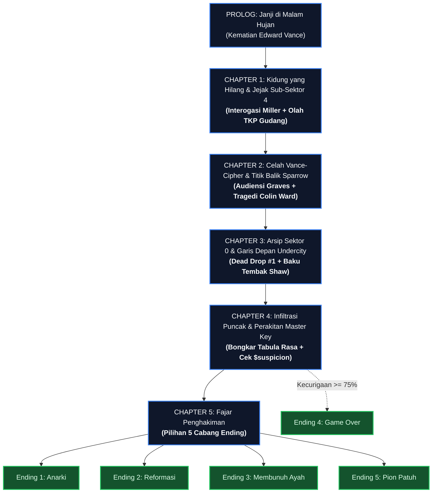
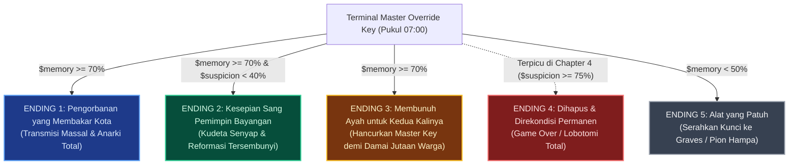

# NASKAH SKENARIO GAME: THE LETHE PROTOCOL (VERSI 5 CHAPTER)
## *Concord 2084: Gema Nusantara di Balik Tirani Teknokrasi*

**Dokumen Rujukan:** Proposal Capstone Project Kelompok 5 (*The Lethe Protocol: Concord 2084*)  
**Format:** Full Playable Screenplay & Narrative Game Script (Versi Ramping 5 Chapter)  
**Pengembang (Kelompok 5):**  
* Harri Supriadi (2405547)  
* Maula Mirza Ananda (2407087)  
* Muhiban Fadlan Nursaid (2400382)  
* Zahran Zaidan Saputra (2415429)  
* Zharfan Faza Wibawa (2403995)  

---

## IKHTISAR PEMADATAN STRUKTUR (8 CHAPTER $\rightarrow$ 5 CHAPTER)

Pemadatan ini dirancang khusus untuk mempercepat produksi game tanpa merusak integritas logika, kedalaman emosional, maupun memicu *plot hole*:

---

## DAFTAR KARAKTER & PROFIL UTAMA

1. **Arthur Vance (Unit V-09 / Mantan Kepala Arsitek Kognitif):**  
   Inspektur elit kepolisian birokrasi *The Registry*. Bersikap dingin dan metodis di luar, namun menyimpan trauma memori mendalam. Sebenarnya ia adalah perancang sistem kognitif rezim yang menyusup untuk menanam pintu belakang *Protokol Jayabaya* sebelum dicuci otak oleh Graves.
2. **Director Lucian Graves (Diktator Teknokrasi):**  
   Direktur Tertinggi *The Registry*. Teknokrat sosiopat berdarah dingin yang membunuh Edward Vance di masa lalu demi menguasai tanah adat dan tambang emas Nusantara, lalu menghapus memori warga agar kejahatannya terkubur selamanya.
3. **Edward Vance (Ayah Arthur / Penjaga Budaya & Sejarah):**  
   Ayah kandung Arthur. Guru sejarah, budayawan, dan tokoh masyarakat Nusantara yang ditembak mati oleh Graves di masa kecil Arthur demi merebut buku besar tanah ulayat. Warisan ukiran kayunya menjadi kunci enkripsi Kuda Troya.
4. **Colin Ward ("Sparrow" / Sahabat Masa Kecil & Peretas):**  
   Sahabat sepermainan Arthur sejak di desa adat. Rekan seperjuangan yang membongkar identitas Arthur di bilik van interogasi sebelum gugur akibat racun otomatis birokrasi.
5. **Garrick Shaw (Komandan Pejuang Undercity):**  
   Mantan perwira keamanan birokrasi yang membelot. Memimpin sayap bersenjata pemberontak di stasiun maglev bawah tanah dan memegang tabung titanium *Dead Drop #2*.
6. **Detective Miles Prescott (Rekan Kerja & Anjing Pengawas Rezim):**  
   Detektif lapangan yang selalu mengawasi kestabilan emosi dan tingkat kepatuhan Arthur dengan kacamata pemindai biometriknya.
7. **Miller (Tahanan 402):**  
   Buruh pabrik Sub-Sektor 4 yang tertangkap membawa kaset radio lagu tidur tradisional, menjadi jembatan penyelidikan pembuka.

---

# PROLOG: JANJI DI MALAM HUJAN DAN KESERAKAHAN PENGUASA

### SCENE P.1: RUMAH PANGGUNG KAYU (MASA LALU)
**LOKASI:** Rumah panggung kayu ulin di pedalaman desa adat Nusantara (sebelum digusur).  
**VISUAL:** Top-Down Pixel Art hangat bernuansa temaram lentera minyak jingga keemasan. Hujan lebat turun di luar jendela. Di atas tikar pandan, Arthur kecil (7 tahun) bersandar di pangkuan ayahnya, **EDWARD VANCE**.  
**AUDIO:** Derai hujan di atap rumbia, desau angin menabrak bambu, gesekan halus pisau raut kayu.  

Edward sedang mengikir lempengan kayu kecil berpola Aksara Nusantara kuno yang meliuk-liuk indah.

EDWARD VANCE  
*(Suara berat, teduh, mengusap lembut kepala Arthur)*  
"Dengarkan hujan di luar, Arthur... Tanah ini punya nyanyiannya sendiri. Setiap tetes air yang jatuh ke akar beringin adalah janji bahwa esok pagi kehidupan akan bersemi kembali."

ARTHUR KECIL  
"Ayah... kenapa huruf ini bentuknya meliuk seperti ombak? Tidak seperti huruf di plang kantor yang kotak dan kaku?"

EDWARD VANCE  
"Karena aksara ini lahir dari detak jantung para leluhurmu, Nak. Mereka menulis bukan untuk menghitung laba tambang atau upah buruh, melainkan untuk menjaga ingatan. Selama aksara ini hidup di dalam dadamu, tanah tumpah darahmu tidak akan pernah bisa dirampas oleh siapa pun."

Edward menyenandungkan tembang pengantar tidur leluhur. Alunan suaranya menyejukkan hati Arthur kecil hingga matanya terpejam damai.

---

### SCENE P.2: SERBUAN GRAVES & KEMATIAN SANG AYAH
**VISUAL:** Layar bergetar (*screen shake*). Pendar lentera emas terkoyak oleh kilatan lampu sorot putih dan laser biru senapan kinetik.  
**AUDIO:** Pintu depan didobrak keras (*BRAAAK!*), derap sepatu laras baja, suara kokangan senjata serbu.  

Empat TENTARA PEMERINTAH mendobrak masuk, menodongkan moncong senapan ke arah Edward. Di belakang mereka, melangkah masuk LUCIAN GRAVES muda dengan seragam birokrasi berkerah tinggi yang dingin.

Edward secara refleks langsung mendekap erat Arthur kecil di balik punggungnya.

LUCIAN GRAVES  
"Edward Vance. Waktu negosiasi sudah habis. Pembangunan Inti Kota Concord tidak bisa ditunda hanya demi sepetak tanah adat usangmu. Di mana buku besar tanah ulayat dan naskah peta geologis itu?"

EDWARD VANCE  
*(Berdiri tegar melindungi Arthur)*  
"Kalian bukan membangun peradaban, Graves! Kalian adalah gerombolan serigala korporat yang mencuri hutan kami, mengeruk gunung emas leluhur, dan menjual pulau-pulau ini ke asing! Tanah ini bukan milik kantormu!"

LUCIAN GRAVES  
*(Mendesah dingin, mengangkat pistol laras panjang berperedam suara)*  
"Maka kau hanyalah residu yang harus dimusnahkan."

**PTHUUUK!**

Tembakan berperedam meletus. Peluru menembus dada Edward. Edward tersentak dan jatuh berlutut di atas lantai kayu yang bersimbah darah.

LUCIAN GRAVES  
"Geledah gudang belakang! Cari naskah pembukuan tanah ulayat itu!"

Pasukan birokrasi bergegas ke belakang. Di ambang mautnya, Edward menggenggam jemari Arthur kecil yang menangis histeris. Ia menyelipkan lempengan kayu berukir aksara Nusantara ke tangan putranya.

EDWARD VANCE  
*(Napasnya tersengal, darah mengalir dari sudut bibirnya)*  
"Arthur... anakku... Simpan ukiran ini... Ini kuncinya... Jangan biarkan mereka menghapus jiwamu... Ingat kidung itu, Thur... Arthur... tolong... jangan pernah lupakan... Ayah..."

Kepala Edward terkulai lemah ke lantai kayu. Detak nadinya berhenti.

---

### SCENE P.3: DISTORSI GLITCH KOGNITIF (TAHUN 2084)
**VISUAL:** Layar mendadak mengalami *chromatic aberration* ekstrem. Retakan piksel merah memecah pemandangan rumah kayu masa lalu. Kamera memotong cepat ke kamar apartemen modern bernuansa abu-abu metalik dan biru neon dingin.  
**AUDIO:** Suara lengkingan frekuensi tinggi (*tinnitus*), disusul dengungan pendingin ruangan apartemen.  

Arthur dewasa terbangun dengan sentakan hebat di atas ranjang kapsul dinasnya. Air mata hangat membasahi pipinya. Tangannya mengepal kosong di dada.

Di depan pintu keluar, cermin pintar (*Biometric Mirror HUD*) memancarkan laser merah pemindai pupil:

`[BIOMETRIC SCAN // HUD-MIRROR VER. 4.8]`  
`SUBJEK: INSPEKTUR ARTHUR VANCE (UNIT V-09)`  
`ANOMALI KOGNITIF: AIR MATA // DETAK JANTUNG +38 BPM`  
`STATUS: MEMORI TIDAK STABIL`

Kompartemen cermin berdesis terbuka, menyodorkan ampul logam berisi **The Tonic (Cognitive Stabilizer No. 9)**.

Arthur menenggak cairan dingin berasa logam itu. Seketika layar mengalami *desaturation*: warna-warna memudar menjadi monokrom kelabu dingin. Air mata Arthur mengering, detak jantungnya mendatar kaku, dan tatapan matanya berubah hampa.

Arthur mengenakan mantel dinas kelabunya, menyematkan lencana Unit V-09, dan melangkah keluar menuju kabut dingin Kota Concord.

---

# CHAPTER 1: KIDUNG YANG HILANG & JEJAK SUB-SEKTOR 4
*(Penggabungan Babak 1: Interogasi Miller & Babak 2: Olah TKP Gudang Industri)*

### SCENE 1.1: RUANG INTEROGASI UNIT V-09 (WHITEHALL COMPLEX)
**LOKASI:** Sayap Interogasi Markas Besar The Registry.  
**VISUAL:** Ruang sempit berdinding beton dingin abu-abu. Meja logam dengan pemutar pita kaset analog kuno. Di kursi seberang duduk **MILLER (Tahanan 402)**, buruh pabrik Sub-Sektor 4 yang terborgol gemetar. DETECTIVE MILES PRESCOTT bersandar di dinding sambil menyeruput kopi sintetisnya.  
**AUDIO:** Derak statis pita kaset analog, dengungan lampu fluorescent.  

PRESCOTT  
"Miller tertangkap di pos pemeriksaan membawa pita magnetik ilegal zaman purba, Vance. Putar rekamannya. Biarkan dia mendengar kejahatannya."

Arthur menekan tombol *Play* pada pemutar kaset.

Suara desis radio tua mengudara, disusul suara merdu seorang ibu menyanyikan lagu tidur tradisional Nusantara.

**Deg!** Jantung Arthur berdenyut kencang. Melodi itu sama persis dengan kidung yang dinyanyikan Edward Vance dalam mimpinya tadi subuh. Layar HUD berkedip mencatat fluktuasi emosi: `BPM: 108`.

MILLER  
*(Menangis tersedu-sedu)*  
"Itu... itu suara ibu saya... Sebelum proyek restrukturisasi menghapus namanya dari data kota... Saat mendengar kaset ini, saya ingat bahwa saya pernah punya keluarga, Pak Inspektur..."

PRESCOTT  
*(Menatap Arthur penuh selidik)*  
"Wajahmu tegang sekali, Vance. Terpikat oleh racun sentimental buronan ini?"

**PILIHAN PEMAIN:**
* **[Opsi A - Taat Regulasi]:** Mematikan kaset secara kasar, memerintahkan Miller dibawa ke unit lobotomi Sektor 0. *($suspicion -10).*
* **[Opsi B - Penelusuran Resonansi]:** Menatap Miller dan bertanya: *"Dari mana kau mendapatkan pemutar kaset berpelindung timbal ini, Miller?"*  
  Miller berbisik: *"Gudang suku cadang lama di Sub-Sektor 4... Seseorang bernama 'Colin' yang memberikannya pada kami..."* *($memory +10, $suspicion +10).*

Prescott mencatat nama "Colin". Panggilan darurat mendadak masuk ke komunikator Prescott: gudang yang dimaksud Miller baru saja disabotase oleh kelompok perlawanan. Keduanya langsung meluncur ke TKP.

---

### SCENE 1.2: GUDANG INDUSTRI TERBENGKALAI (SUB-SEKTOR 4)
**LOKASI:** Distrik Buruh Industri Sub-Sektor 4.  
**VISUAL:** Gudang semen basah berlumpur, pipa uap panas mendesis di dinding berlumut. Pintu darurat telah dijebol.  
**AUDIO:** Suara tetesan air hujan asam, desis uap pipa bocor.  

Arthur dan Prescott menyisir lokasi untuk melakukan olah TKP:

1. **Puntung Rokok Kretek (Black Clove):** Di dekat tong oli berkarat, Arthur menemukan puntung rokok kretek beraroma cengkeh manis asli Nusantara—tembakau terlarang yang hanya beredar di jaringan perlawanan selatan.
2. **Coretan Hex di Kisi Ventilasi:** Di bawah senter UV, ventilasi memperlihatkan coretan cat fosfor:  
   `0x4F5552 // T-CORE // SPARROW`  
   Arthur terkejut dalam batin: *T-CORE* adalah istilah arsitektur komputasi tingkat tinggi yang hanya dirancang oleh perancang sistem elit The Registry!
3. **Puzzle Rekonstruksi Hologram Aksara (Affine Transformation):**  
   Di balik lempengan besi generator tua, Arthur menemukan proyektor saku hologram yang menampilkan pecahan garis emas teracak.  
   *Mekanik Puzzle:* Pemain memanipulasi Translasi (geser), Rotasi (putar), dan Skalasi (ubah ukuran) hingga potongan garis mengunci membentuk satu karakter Aksara Nusantara kuno: **"JA"**.

**KLIK!**  
Kompartemen generator terbuka meluncur. Di dalamnya terdapat peta saluran air yang mengarah langsung ke **Dok Pelabuhan Whitehall Bawah**, beserta secarik catatan tangan:

"Thur, temui aku di batas air sebelum Graves menutup jaringnya. - Colin"

Catatan itu menyebut nama panggilannya: "Thur".

**PILIHAN KEPUTUSAN:**
* **[Lapor Resmi ke Prescott]:** Arthur menunjukkan kompartemen rute ke dok bawah tanpa menyentuh kertas. Prescott langsung mengontak divisi taktis. *($suspicion -15).*
* **[Sembunyikan Catatan]:** Arthur meremas catatan ke dalam sakunya dan berbohong bahwa generator hanya korslet. Prescott menatap curiga. *($suspicion +15, $memory +15).*

---

# CHAPTER 2: CELAH VANCE-CIPHER & TITIK BALIK SPARROW
*(Penggabungan Babak 3: Audiensi Graves & Babak 4: Tragedi Interogasi Colin Ward)*

### SCENE 2.1: LANTAI 80 MENARA EKSEKUTIF (AUDIENSI GRAVES)
**LOKASI:** Kantor Direktur Lucian Graves, Lantai 80 Whitehall Complex.  
**VISUAL:** Ruang bundar monolitik berdinding kaca raksasa menghadap malam Kota Concord. Meja kerja obsidian hitam pekat dengan terminal kuantum di tengahnya.  
**AUDIO:** Dengungan medan penstabil gravitasi ruangan, nada suara Graves yang berat berwibawa.  

Graves memanggil Arthur ke meja kerjanya. Proyeksi holografik biru safir membubung, menampilkan jutaan baris kode peretasan brankas data negara (*Deep Vault*).

LUCIAN GRAVES  
"Dini hari tadi, Deep Vault ditembus selama 40 milidetik oleh buronan bernama sandi 'Sparrow'. Perhatikan algoritma yang digunakannya, Vance."

Di tengah lautan data biru, satu blok kode enkripsi memancarkan pendar keemasan:

`ALGORITHM: VANCE-CIPHER_REV3`  
`BACKDOOR LATENCY: 0.040s // ASYMMETRIC LOGIC GATE`  
`SYNTAX BASE: OLD NUSANTARA CHAR-MAP`

Arthur terpaku. *Vance-Cipher*? Algoritma ini menggunakan namanya sendiri! Struktur sintaksis dan efisiensi gerbang logikanya adalah gaya berpikir Arthur sendiri sebelum memorinya dihapus.

GRAVES  
"Kode ini memiliki tanda tangan intelektual yang langka, Vance. Buronan Sparrow baru saja terdeteksi di dok kargo Whitehall Bawah. Ambil token penyerbuan ini. Pimpin pasukan elit, bawa dia hidup-hidup ke van komando taktis!"

---

### SCENE 2.2: BILIK VAN KOMANDO TAKTIS & PENGAKUAN COLIN WARD
**LOKASI:** Bilik Interogasi Kedap Suara di dalam Van Taktis (Whitehall Bawah).  
**VISUAL:** Lampu merah redup di dalam van baja. Tersangka diikat borgol magnetik ke tiang: **COLIN WARD ("Sparrow")**, babak belur berdarah. Prescott mengunci pintu van dari luar untuk memberi Arthur waktu 10 menit.  
**AUDIO:** Gemercik air laut di luar van, derak borgol besi.  

Colin menatap Arthur dengan tatapan terkejut, lalu tersenyum pedih dengan air mata mengalir di pipinya.

COLIN WARD  
"Thur...? Kamu benar-benar sudah lupa ya, Thur? Ini aku, Colin! Kita tumbuh besar bersama di desa adat sebelum digusur! Kita yang bersumpah di depan nisan ayahmu, **EDWARD VANCE**, untuk meruntuhkan rezim korup ini!"

**BLARRR!**  
Nama "Edward Vance" meledakkan amnesia di kepala Arthur. Dinding kabut runtuh seketika!

COLIN WARD  
*(Berteriak dengan emosi meledak-ledak)*  
"Graves membunuh ayahmu demi mencuri buku besar tanah ulayat! Elit birokrasi menjual hutan, emas, dan pulau-pulau kita ke pihak asing, lalu membagi-bagi triliunan kredit itu ke rekening mereka! Dan agar rakyat tidak memberontak, mereka menciptakan *The Lethe Protocol* untuk mencuci otak warga!  
Kamu yang merancang sistem itu, Arthur! Kamu Kepala Arsitek Kognitifnya! Kamu menanam pintu belakang **Protokol Jayabaya** dengan sandi aksara ayahmu! Tapi Graves mencium rencanamu dan mencuci otakmu dengan mesin ciptaanmu sendiri!"

`[MEMORY RECONSTRUCTION: CRITICAL IMPACT // $memory +35% (TOTAL: 65%)]`

Arthur jatuh berlutut di lantai van, menangis tersedu-sedu mencengkeram kepalanya.

ARTHUR VANCE  
"Colin... Ya Tuhan... Colin... Sahabatku..."

---

### SCENE 2.3: RACUN OTOMATIS & WASIAT KEMATIAN COLIN
**VISUAL:** Sirine bahaya otomatis berbunyi melengking di langit-langit van. Peringatan merah menyala di monitor van:  
`[OVERRIDE OTOMATIS // FAILSAFE PROTOKOL GRAVES DIJALANKAN]`  
**AUDIO:** Suara histeris sirine, desis hidrolik jarum mikro di kerah baju Colin.  

Sebuah jarum mikro menyembul dari kerah baju tahanan Colin, menyuntikkan racun saraf neurotoksin hijau pekat ke lehernya. Tubuh Colin mengejang hebat, busa putih keluar dari bibirnya, dan urat lehernya menghitam.

ARTHUR VANCE  
"Tidak! Bertahanlah, Colin! Bertahanlah!"

Colin megap-megap dalam pelukan Arthur. Dengan sisa tenaga terakhirnya, jarinya yang berlumuran darah menorehkan pesan di kaca jendela van:  
`SEKTOR 0 // LACI 884-B`

COLIN WARD  
*(Berbisik parau sambil tersenyum damai)*  
"Selesaikan... tugas ayahmu, Thur... Ambil ukiran ayahmu di laci itu... temui Garrick Shaw di Undercity... Bebaskan kota ini..."

Kepala Colin terkulai lunglai di pundak Arthur. Denyut nadinya berhenti selamanya. Arthur meraung memeluk jasad sahabatnya dalam kebisuan van kedap suara.

---

# CHAPTER 3: ARSIP SEKTOR 0 & GARIS DEPAN UNDERCITY
*(Penggabungan Babak 5: Arsip Fisik & Babak 6: Baku Tembak Stasiun Maglev)*

### SCENE 3.1: ADU ALIBI DENGAN PRESCOTT & INFILTRASI LACI 884-B
**LOKASI:** Pintu Van Taktis $\rightarrow$ Arsip Bawah Tanah Sektor 0.  
**VISUAL:** Prescott membuka pintu van dengan pistol terhunus. Arthur berhasil memasang alibi dingin bahwa Colin tewas karena failsafe racun sebelum sempat membocorkan selnya.  

Tengah malam, Arthur menyusup ke Arsip Fisik Sektor 0. Menghindari kerucut sensor drone pemindai, Arthur menemukan **Laci 884-B**. Ia memasukkan tanggal peluncuran arsitektur kognitif masa lalunya pada dial angka kuno: **1 - 2 - 0 - 9 - 4**.

**KLIIK... SSSSHHH!**  
Laci terbuka, memperlihatkan **Dead Drop #1**:
1. **Lempengan Ukiran Kayu Beraksara Nusantara** milik Edward Vance.
2. **Kaset Mikro Analog Kuno** berisi rekaman suara Arthur masa lalu.

Rekaman diputar di earphone Arthur:  
*"Dengarkan, Arthur... Kau yang menanam Protokol Jayabaya. Kunci logikanya ada pada ukiran kayu ayahmu. Tapi modul fisik peluncurnya ada pada Komandan Garrick Shaw. Graves sedang mengirim pasukan untuk membantai markas Shaw di stasiun maglev tua Undercity. Pergilah ke sana, satukan kuncinya!"*

`[DEAD DROP #1 DIAMANKAN: UKIRAN EDWARD & KASET REKAMAN // $memory +20%]`

---

### SCENE 3.2: MEDAN TEMPUR STASIUN MAGLEV & GARRICK SHAW
**LOKASI:** Stasiun Maglev Tua Bawah Tanah (The Undercity).  
**VISUAL:** Terowongan rel gelap berbau belerang dan limbah, diterangi kilatan tembakan kinetik merah dan biru. Asap tebal membubung dari gerbong maglev reyot. Pasukan birokrasi bersenjata berat beradu tembak sengit dengan barisan pejuang gerilya.  
**AUDIO:** Rentetan senapan serbu beruntun, gema proyektil memantul di rel baja.  

Di seberang rel, berdiri komandan pemberontak **GARRICK SHAW**. Pria kekar bertangan bionik itu menembakkan senapannya sambil mengapit rokok kretek *Black Clove*. Dari saku rompinya, terlihat tabung silinder titanium: **Dead Drop #2**.

GARRICK SHAW  
*(Berteriak murka menatap Arthur)*  
"Arthur Vance! Anjing algojo Whitehall! Kau membunuh Colin dan sekarang kau datang membawa pasukan Graves untuk membantai kami semua?!"

Perwira pasukan biro di samping Arthur mengokang peluncur granat fosfor pembakar:  
"Beri perintah tembak, Inspektur! Kita bisa ratakan stasiun ini dalam sekali serang!"

**PILIHAN KEPUTUSAN MORAL PEMAIN:**
* **[Opsi Taat - Pembantaian demi Penyamaran]:**  
  Arthur memerintahkan menembakkan fosfor. Stasiun meledak terbakar. Shaw roboh tewas dengan tatapan mengutuk Arthur. Arthur mengambil tabung titanium Dead Drop #2 dari mayat Shaw yang hangus.  
  *(Dampak: $suspicion turun drastis -25, $memory +10).*
* **[Opsi Sabotase - Mundur Palsu & Aliansi Rahasia]:**  
  Arthur berteriak panik palsu: *"Tahan tembakan! Ada ranjau resonansi seismik di bawah bantalan rel! Mundur ke perimeter luar sekarang!"* Pasukan biro mundur. Arthur melompati barikade dan membisikkan sandi Kuda Troya: *"Gema Nusantara di atas batu karang! 12094! Colin menitipkan ini padaku, Shaw!"*  
  Shaw terharu, menyerahkan tabung titanium Dead Drop #2, dan meloloskan pasukannya lewat gorong-gorong air.  
  *(Dampak: $suspicion naik tajam +30, $memory +25).*

`[DEAD DROP #2 DIAMANKAN: TABUNG SILINDER TITANIUM]`

---

# CHAPTER 4: INFILTRASI PUNCAK & PERAKITAN MASTER KEY
*(Adaptasi Babak 7: Labirin Kebenaran di Lantai Puncak)*

### SCENE 4.1: INFILTRASI KANTOR GRAVES (MALAM BADAI PETIR)
**LOKASI:** Ruang Kerja Direktur Graves, Lantai 80 Menara Eksekutif.  
**VISUAL:** Ruangan obsidian gelap gulita, hanya diterangi kilatan petir tropis raksasa di luar dinding kaca jendela. Arthur menyelinap masuk membawa tiga artefak: Lempengan Kayu Edward, Kaset Mikro, dan Tabung Silinder Titanium.  
**AUDIO:** Gemuruh guntur dahsyat, desau angin badai, dengungan konsol kuantum.  

Arthur menancapkan tabung titanium ke slot konsol kuantum meja kerja Graves dan menempelkan lempengan kayu ayahnya ke atas pemindai optik meja.

---

### SCENE 4.2: GERBANG AMBANG KECURIGAAN

#### JIKA $SUSPICION >= 75%: LANGSUNG MEMICU ENDING 4 (GAME OVER)
Lampu sorot merah menyala menyilaukan. Pintu baja hidrolik membanting tertutup. Graves, Prescott, dan pasukan elit menyergap Arthur dari balik pilar obsidian.

LUCIAN GRAVES  
"Tingkat kewaspadaan biro terhadapmu mencapai batas kritis, Inspektur Vance. Prescott telah mencatat setiap kedipan matamu."

Proyektil kejut saraf melumpuhkan Arthur ke lantai marmer. Seluruh artefak disita. Jarum suntik *neuro-injeksi* konsentrasi tinggi ditancapkan ke tengkuk Arthur, menghapus seluruh ingatan, jati diri, dan memorinya selamanya.  
*(Transisi langsung ke narasi **Ending 4: Dihapus & Direkondisi Permanen**).*

---

#### JIKA $SUSPICION < 75%: OTENTIKASI ARSITEK & BONGKAR PROJECT TABULA RASA
Konsol kuantum membaca lekukan aksara Nusantara pada kayu Edward Vance dan mendekripsi frekuensi dari silinder titanium. Pendar cahaya biru keemasan membubung dari meja kerja.

`[OTENTIKASI ARSITEK DITERIMA // WELCOME BACK, LEAD ARCHITECT VANCE]`  
`KUNCI LOGIKA: PROTOKOL JAYABAYA TERVERIFIKASI`  
`BERKAS RAHASIA: PROJECT TABULA RASA DIBUKA`

Layar panorama membeberkan bukti mega-kejahatan rezim:
1. Rekening korupsi triliunan kredit hasil perampasan tambang emas dan pulau-pulau adat Nusantara.
2. Rekaman satelit penggusuran paksa dan detik-detik eksekusi Edward Vance.
3. Daftar jutaan warga Concord yang dicuci otaknya menggunakan *The Tonic*.

Dari slot meja marmer, meluncur keluar sebuah drive portabel berbentuk kristal prisma bercahaya biru elektrik: **The Master Override Key**.

Arthur mengantongi kunci itu di sakunya. Waktunya menyongsong fajar penghakiman.

---

# CHAPTER 5: FAJAR PENGHAKIMAN & 5 ENDING
*(Adaptasi Babak 8: Meja Kerja 07:00 & Dokumentasi Lengkap 5 Ending)*

### SCENE 5.1: MEJA KERJA ARTHUR (PUKUL 07:00 PAGI)
**LOKASI:** Lantai Operasional Whitehall Complex.  
**VISUAL:** Cahaya matahari fajar menyinari ratusan kubikel pegawai yang bekerja kaku dalam keheningan total. Di seberang meja, Prescott duduk menyeruput kopi paginya.  
Di bawah meja kerja Arthur, kabel transmisi terminal dinas telah terhubung langsung ke satelit pemancar kognitif nasional Kota Concord.  
**AUDIO:** Detik jam digital raksasa, langkah patroli rutin di lorong.  

Di sakunya, Arthur menggenggam **The Master Override Key**.

PRESCOTT  
"Fajar yang damai di Concord, bukan, Vance? Operasi Undercity semalam sukses total. Kota ini kembali selaras sempurna."

ARTHUR VANCE  
"Ya, Prescott... Sebentar lagi, kota ini akan menyaksikan masa depan yang sesungguhnya."

Arthur menempelkan Master Override Key ke slot terminal di bawah mejanya. Layar monitor tersembunyi memancarkan pilihan eksekusi nasib akhir kota:

---

### DOKUMENTASI LENGKAP 5 RESOLUSI ENDING

#### 1. ENDING 1: PENGORBANAN YANG MEMBAKAR KOTA *(AKHIR ANARKI)*
* **Syarat:** `$memory >= 70%`.
* **Skenario:** Arthur menancapkan kunci ke pemancar nasional. Layar-layar raksasa di seluruh gedung Concord menayangkan buku besar korupsi Graves, rekaman pembantaian tanah adat, dan tembang tidur Edward Vance. Amnesia jutaan rakyat runtuh seketika; kesedihan meledak menjadi amarah liar. Rakyat membakar markas kementerian dan menggantung pejabat korup. Helikopter Graves ditembak jatuh. Arthur berdiri di atas gedung yang terbakar, menangis menyaksikan kota tenggelam dalam lautan api perang saudara. Kebenaran ditegakkan, namun dibayar dengan anarki total.

#### 2. ENDING 2: KESEPIAN SANG PEMIMPIN BAYANGAN *(REFORMASI SENYAP)*
* **Syarat:** `$memory >= 70%` dan `$suspicion < 40%`.
* **Skenario:** Memanfaatkan aksesnya yang bersih dari kecurigaan, Arthur meretas implan saraf kognitif Direktur Graves dan seluruh Dewan Direksi dari jarak jauh. Esok paginya, Graves mengumumkan pengunduran diri dan menyerahkan mandat kepemimpinan kepada Arthur Vance. Arthur memimpin The Registry dari balik bayang-bayang. Ia menanggung hidup dalam kesepian mutlak tanpa keluarga dan sahabat, namun setiap malam diam-diam mengalirkan triliunan kredit korporasi ke rumah sakit rakyat dan menyiarkan dongeng/lagu Nusantara secara bertahap ke sekolah pinggiran untuk memulihkan kemanusiaan tanpa menumpahkan setetes darah pun.

#### 3. ENDING 3: MEMBUNUH AYAH UNTUK KEDUA KALINYA *(AKHIR PALING TRAGIS)*
* **Syarat:** `$memory >= 70%`.
* **Skenario:** Arthur menyadari bahwa membongkar kebenaran instan akan memicu perang saudara, kelaparan, dan pembantaian jutaan orang tak bersalah. Dengan tangan gemetar dan air mata bercucuran, Arthur mencabut Master Override Key, meletakkannya di lantai, dan **menginjaknya hingga hancur berkeping-keping**. Rekaman sejarah dan bukti tentang ayahnya musnah selamanya. Arthur meraung dalam keheningan kubikelnya, sadar ia telah "membunuh" ayahnya untuk kedua kalinya demi menjaga kedamaian palsu bagi jutaan warga kota. Ia menolak *The Tonic* dan memikul dosa ini sendirian sampai akhir hayat.

#### 4. ENDING 4: DIHAPUS & DIREKONDISI PERMANEN *(GAME OVER)*
* **Syarat:** `$suspicion >= 75%` (Terpicu di Chapter 4).
* **Skenario:** Arthur disergap di ruang kerja Graves sebelum sempat merakit kunci. Ia dilumpuhkan dengan pengekang neural dan disuntik neuro-injeksi penghapus kepribadian total di laboratorium Sektor 0. Arthur Vance lenyap selamanya; keesokan harinya birokrasi memiliki inspektur baru yang patuh, dingin, dan tidak akan pernah bermimpi lagi.

#### 5. ENDING 5: ALAT YANG PATUH *(THE OBEDIENT PAWN)*
* **Syarat:** `$memory < 50%`.
* **Skenario:** Arthur gagal merekonstruksi memorinya. Menganggap kunci tersebut adalah virus teroris yang membahayakan ketertiban, Arthur menyerahkan seluruh modul ke meja Graves. Graves memberinya Medali Keselarasan dan pil *The Tonic* formula emas. Arthur kembali ke apartemennya, meminum obatnya, dan tersenyum hampa menatap cermin biometrik. Arthur hidup damai selamanya sebagai pion tanpa jiwa dalam ketidaktahuan mutlak.

---

## ANALISIS LOGIKA & ELIMINASI PLOT HOLE

| Potensi Resiko Plot Hole | Solusi Logika dalam Versi 5 Chapter |
| :--- | :--- |
| **Kenapa Arthur tiba-tiba menyelidiki gudang Sub-Sektor 4?** | Pengakuan tersangka **Miller** di Scene 1.1 menyebutkan bahwa kaset lagu tidur didapat dari buronan bernama **Colin** di gudang Sub-Sektor 4. Ini menciptakan jembatan kausalitas langsung dan alami ke Scene 1.2. |
| **Bagaimana Graves mengetahui pembobolan Deep Vault dan kenapa Arthur yang dikirim?** | Di Chapter 2, peretasan menggunakan algoritma `VANCE-CIPHER_REV3`. Graves memanggil Arthur karena tanda tangan kodenya langka, dan token penyerbuan dok langsung diberikan Graves kepada Arthur untuk memburu "Sparrow". |
| **Dari mana Arthur tahu lokasi Dead Drop #1 di Sektor 0?** | Sebelum tewas akibat racun otomatis di van komando, Colin menuliskan koordinat `SEKTOR 0 // LACI 884-B` dengan darahnya di kaca van. |
| **Kenapa Arthur langsung menuju Undercity setelah membuka laci?** | Kaset rekaman suara Arthur masa lalu di dalam Laci 884-B secara eksplisit menginstruksikan Arthur untuk menemui **Garrick Shaw** yang sedang diserbu di stasiun maglev Undercity guna mengambil modul fisik kedua (*Dead Drop #2*). |
| **Bagaimana Arthur bisa masuk ke ruang kerja Graves di Chapter 4?** | Arthur adalah inspektur elit dengan token akses otoritas penuh dari Chapter 2, dan ia menyusup pada tengah malam saat badai petir ketika kantor lantai 80 kosong. |
| **Apakah 5 Ending tetap bisa dicapai dengan seimbang?** | Bobot perolehan `$memory` dan `$suspicion` telah dikalibrasi ulang (misal: pengakuan Colin langsung memberi +35% memori, konfrontasi Shaw memberi $\pm 25$–$30$). Dengan demikian, seluruh ambang batas ending (>=70%, <40%, >=75%, <50%) dapat dicapai secara proporsional. |

---
*(AKHIR NASKAH LENGKAP VERSI 5 CHAPTER)*
